# NYC Short-Term Rental Price ML Pipeline

A reproducible training pipeline for estimating nightly prices from historical New York City short-term rental listings. The project combines configurable orchestration, data-quality gates, tabular and text feature engineering, experiment tracking, and versioned model artifacts.

- [Weights & Biases experiments and artifacts](https://wandb.ai/jameschang1992/nyc_airbnb)
- [Versioned releases](https://github.com/trzhang-ai/build-ml-pipeline-for-short-term-rental-prices/releases)

## What the pipeline does

- Orchestrates selectable steps with MLflow Projects and Hydra configuration.
- Cleans duplicate and invalid records, enforces price limits, and filters coordinates to the NYC area.
- Validates schema, row count, categorical values, geographic boundaries, price range, and neighbourhood-distribution drift.
- Creates reproducible train, validation, and test splits stratified by borough.
- Builds a scikit-learn inference pipeline with categorical encoding, missing-value handling, recency features, TF-IDF features from listing titles, and Random Forest regression.
- Logs datasets, lineage, parameters, metrics, feature importance, and serialized model artifacts to W&B.

## Architecture

```mermaid
flowchart LR
    A["Historical listing sample"] --> B["Cleaning and NYC boundary filters"]
    B --> C["Schema, range, and distribution checks"]
    C --> D["Stratified train / validation / test split"]
    D --> E["Tabular preprocessing and title TF-IDF"]
    E --> F["Random Forest regressor"]
    F --> G["Versioned W&B model artifact"]
    G -. "manual candidate promotion" .-> H["Holdout regression test"]
```



The default run stops after training and artifact publication. The holdout regression test is intentionally explicit because it depends on a model artifact that has first been reviewed and assigned the W&B `prod` alias.

## Verified historical result

The following metrics come from a previously verified remote run of Release `1.0.1` with `sample2.csv`:

| Release | Input sample | R² | MAE |
| --- | --- | ---: | ---: |
| [`1.0.1`](https://github.com/trzhang-ai/build-ml-pipeline-for-short-term-rental-prices/releases/tag/1.0.1) | `sample2.csv` | `0.6237` | `$31.63` |

Release [`1.0.2`](https://github.com/trzhang-ai/build-ml-pipeline-for-short-term-rental-prices/releases/tag/1.0.2) updates dependency compatibility. It is the latest published release, but the table above must not be interpreted as a fresh metric run for `1.0.2`.

## Configuration

Runtime behavior is controlled by [`config.yaml`](config.yaml), including:

- the input sample and accepted nightly price range;
- the KL-divergence threshold used by the neighbourhood-distribution check;
- train, validation, and test split parameters;
- TF-IDF vocabulary size; and
- Random Forest hyperparameters.

Hydra overrides make experiments reproducible without editing source code. For example:

```bash
mlflow run . \
  -P steps=train_random_forest \
  -P hydra_options="modeling.random_forest.max_depth=10,15 modeling.max_tfidf_features=15,30 -m"
```

## Run locally

Prerequisites:

- Conda
- a W&B account and API key
- network access for dependency resolution and artifact operations

Create the development environment:

```bash
conda env create -f environment.yml
conda activate nyc_airbnb_dev
wandb login
```

Run the complete training path:

```bash
mlflow run .
```

Run selected steps:

```bash
mlflow run . -P steps="download,basic_cleaning,data_check"
```

After reviewing a model artifact and assigning it the W&B `prod` alias, run the holdout test explicitly:

```bash
mlflow run . -P steps=test_regression_model
```

Run a published release against another bundled sample:

```bash
mlflow run \
  https://github.com/trzhang-ai/build-ml-pipeline-for-short-term-rental-prices.git \
  -v <release-tag> \
  -P hydra_options="etl.sample='sample2.csv'"
```

## Repository layout

```text
.
├── main.py                         # MLflow/Hydra orchestration
├── config.yaml                     # Data and model configuration
├── EDA.ipynb                       # Exploratory data analysis
├── src/
│   ├── basic_cleaning/             # Cleaning and geographic filters
│   ├── data_check/                 # Pytest-based data-quality gates
│   ├── eda/                        # Isolated EDA environment
│   └── train_random_forest/        # Feature and model pipeline
└── components/                     # Reusable MLflow components and utilities
```

## Limitations

- The bundled data is historical and does not represent a live rental marketplace.
- The evaluation uses random stratified splits rather than a time-based backtest.
- W&B artifact aliases such as `latest`, `reference`, and `prod` are mutable; operational deployments should pin immutable artifact versions.
- Model review and candidate promotion are manual. This repository does not implement scheduled retraining, automated promotion, monitoring, or rollback.
- The Random Forest is a practical baseline, not evidence of production pricing accuracy.
- This repository produces versioned training artifacts; it does not expose an online inference service.

## Provenance and license

This repository is a fork of an Udacity MLOps project scaffold. The work in this fork completes and extends the pipeline wiring, data cleaning and validation, feature/model training, compatibility updates, and versioned release verification. It should be described as a completed learning project, not as an independently created production system or employment deliverable.

The original educational content and scaffold remain governed by [`LICENSE.txt`](LICENSE.txt). The license and fork provenance are intentionally retained.
